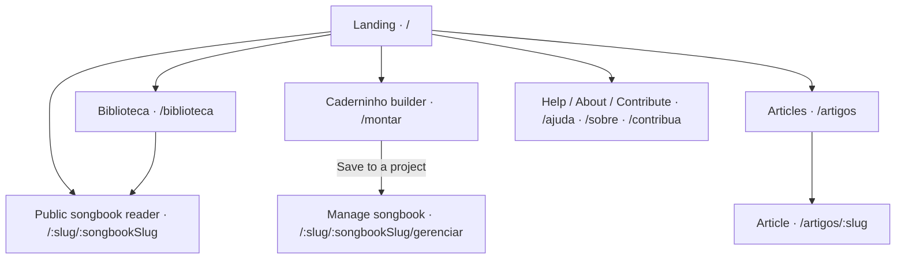
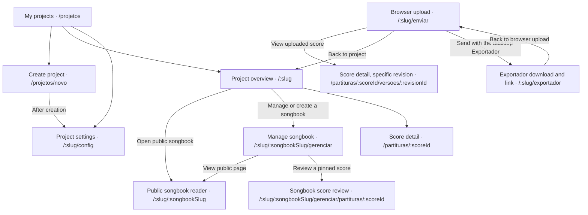

# Web app flows

Each box pairs a screen with its canonical URL. Arrows show selected user journeys, not React Router nesting or every available link. The sources of truth are [the screen bindings](../src/tsx/App.tsx) and [the route patterns](../src/lib/routes.ts).

## Discover, read, and build

## Projects, scores, and review

- **Flags and access:** Project and songbook routes are registered only with `FEATURE_FLAG_COLLAB_FLOW`; browser upload additionally requires `FEATURE_FLAG_BROWSER_UPLOAD`. The Exportador page is registered with the project routes; it downloads the desktop app (latest GitHub release) and opens or copies the `cadernin-export://` link for the same upload context. Route registration is not permission to view or edit a resource. The two score detail URLs render the same `ScorePage`; the explicit revision URL selects a specific revision. Songbook review is separate and shows the score in the context of that songbook.
- **Same URL, different state:** Sign-in and profile/inbox open as app-level modals, not routes. File, parts, metadata, formatting, and submission are steps within the upload route.
- **Fallback:** Unmatched URLs show Not Found. Legacy year-only links redirect to `/` when handled by the SPA and no static page takes precedence; reserved names cannot resolve as project slugs.
